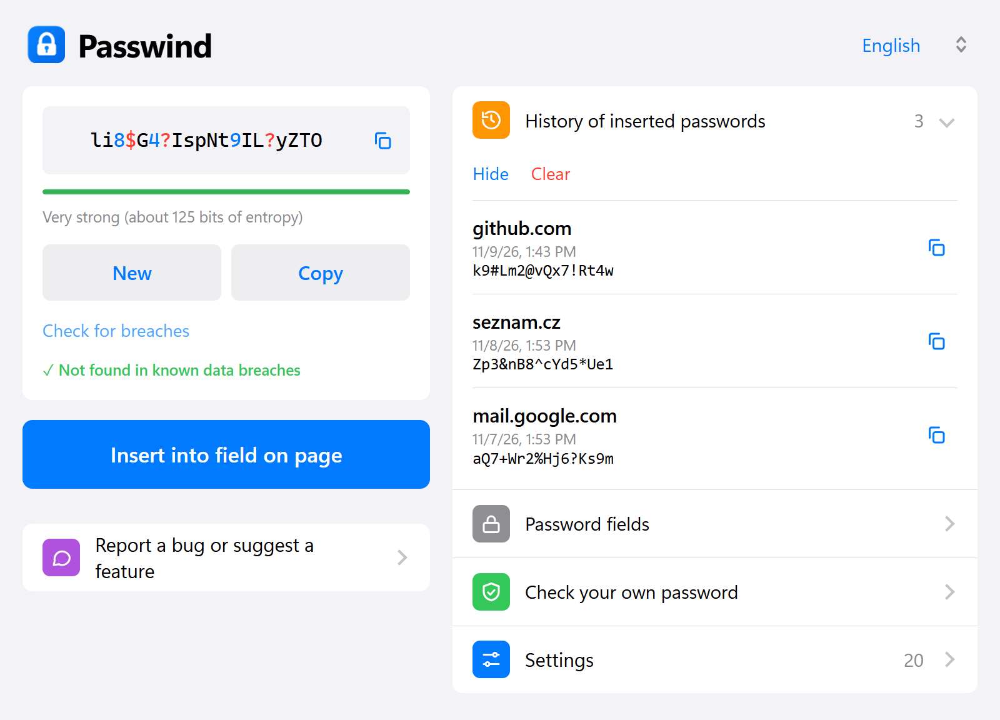

# Passwind - Password Generator for Chrome

Strong passwords in one click, an offer right at the password field, breach check, history of inserted passwords and automatic clipboard clearing. Everything runs locally in your browser.

**Website and privacy policy:** https://sturmjan.github.io/passwind/ (source in `docs/index.html`)

## Features

- 8-64 characters, upper/lower case, digits, symbols, custom allowed characters, look-alike exclusion (I l 1 O 0)
- Offer at password fields (automatic on sign-up forms), fills the confirmation field too, right-click menu entry
- Show the password in the field (hover, double click, focus or Ctrl) with a copy icon right in the field
- Breach check via Have I Been Pwned (k-anonymity: only 5 hash characters are sent)
- History of inserted passwords (until the browser closes / permanent / off)
- Automatic clipboard clearing (30 s / 1 min / 2 min)
- 7 languages (en, cs, de, es, pt, fr, it), light and dark mode

## Install

Chrome Web Store: coming soon. Until then:

1. Download this repository (Code -> Download ZIP) and unzip it.
2. Open `chrome://extensions` and enable **Developer mode**.
3. Click **Load unpacked** and choose the folder that contains `manifest.json`.

## Bugs and ideas

Open an [issue](https://github.com/sturmjan/passwind/issues/new/choose) (English or Czech). Please **never paste real passwords**.

## Project layout

| Path | Contents |
| --- | --- |
| `manifest.json` | Manifest V3 |
| `src/` | `content.js` (page fields), `background.js` (menu, clipboard timer), `generator.js`, `i18n.js`, `hibp.js`, `offscreen.*` |
| `popup/` | extension popup |
| `_locales/` | store name and description |
| `tools/` | icon script, `demo-signup.html` test page |
| `docs/` | website + screenshots (GitHub Pages) |
| `STORE.md` | Chrome Web Store listing notes |

## License

MIT, see `LICENSE`.

---

## Česky

Rozšíření pro Chrome: silná hesla jedním klikem, nabídka u pole pro heslo, kontrola úniku, historie vložených hesel a mazání schránky. Vše běží lokálně v prohlížeči. Chyby a nápady zakládejte jako issue na GitHubu (česky i anglicky). Ruční instalace: `chrome://extensions` -> Režim pro vývojáře -> Načíst rozbalené.
